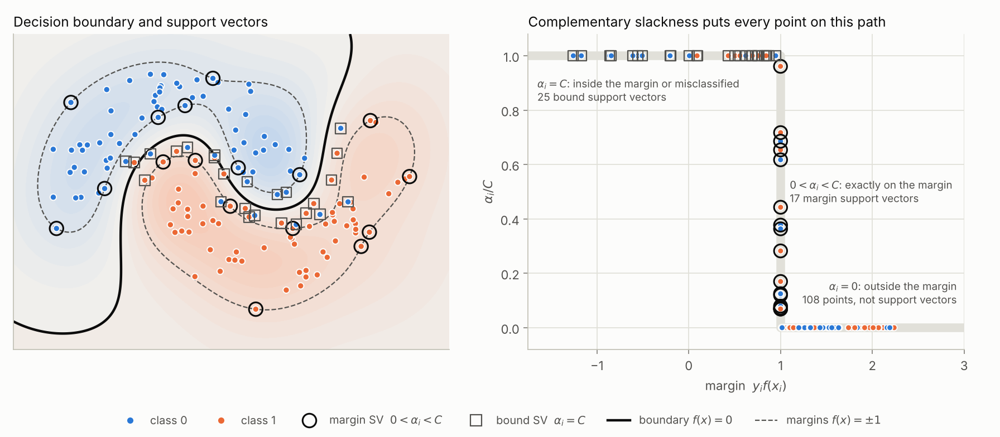
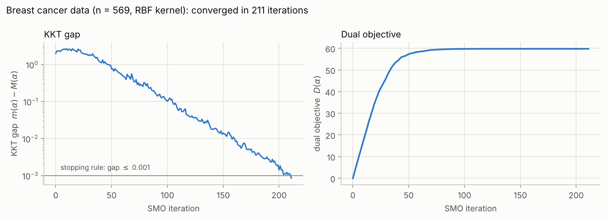
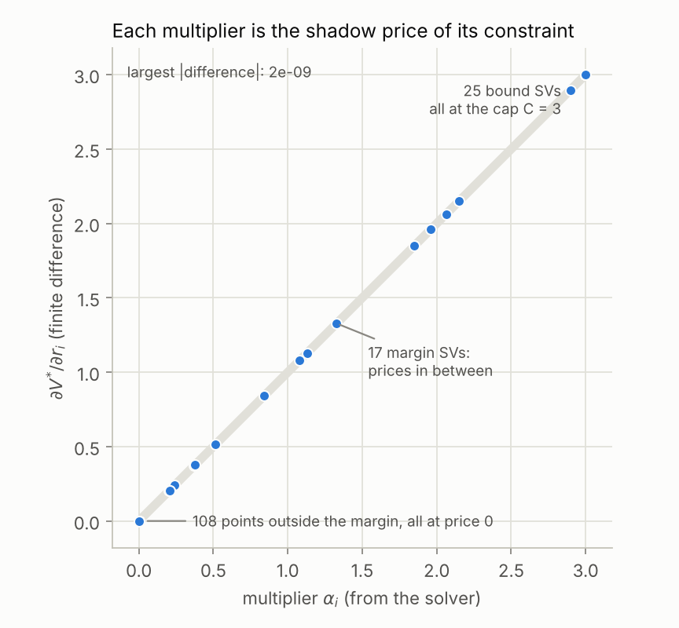

# KKT-SVM

A support vector machine written from scratch in NumPy, in which the **Karush–Kuhn–Tucker (KKT) conditions** drive training. They choose which two Lagrange multipliers to update at each step, decide when training is finished, and sort the training points into support vectors and non-support vectors. Each multiplier also has an economic reading as a **shadow price**, which the code checks numerically.

On five benchmark problems it makes the same predictions and finds the same support vectors as scikit-learn's `SVC` (LIBSVM).



## Quickstart

```bash
git clone https://github.com/navinokcan/Support-Vector-Machine.git
cd Support-Vector-Machine
pip install -r requirements.txt
pytest
```

```python
from sklearn.datasets import make_moons
from svm_kkt import KKTSVM, kkt_report

X, y = make_moons(150, noise=0.25, random_state=7)
model = KKTSVM(C=3.0, kernel="rbf", gamma=2.0).fit(X, y)

model.margin_support_   # support vectors exactly on the margin (0 < alpha < C)
model.bound_support_    # support vectors inside the margin (alpha = C)
kkt_report(model, X, y) # every KKT condition, recomputed from the fitted model
```

## The maths

### The problem

The soft-margin SVM looks for the widest margin that most points respect, paying a penalty $`C`$ per unit of violation:

```math
\min_{w,\,b,\,\xi}\ \ \tfrac12\lVert w\rVert^2 + C\sum_{i=1}^{n}\xi_i
\qquad\text{subject to}\qquad
y_i f(x_i) \ \ge\ 1-\xi_i,\quad \xi_i \ge 0, \qquad f(x) = w^\top\phi(x) + b .
```

Each training point has a margin constraint with multiplier $`\alpha_i`$ and a slack constraint with multiplier $`\mu_i`$.

### The KKT conditions

| Condition | Equations |
|---|---|
| Stationarity | $`w=\sum_i\alpha_i y_i\phi(x_i)`$,  $`\sum_i\alpha_i y_i=0`$,  $`\alpha_i+\mu_i=C`$ |
| Primal feasibility | $`y_i f(x_i)\ge 1-\xi_i`$,  $`\xi_i\ge0`$ |
| Dual feasibility | $`\alpha_i\ge0`$,  $`\mu_i\ge0`$, so $`0\le\alpha_i\le C`$ |
| Complementary slackness | $`\alpha_i\,[y_i f(x_i)-1+\xi_i]=0`$,  $`\mu_i\xi_i=0`$ |

The problem is convex with affine constraints, so these conditions are necessary and sufficient for optimality.

**Complementary slackness picks out the support vectors.** A multiplier can only be non-zero if its constraint binds, so every point falls into one of three cases. These are the three legs of the path in the right-hand panel above:

| Multiplier | Forced by complementary slackness | Meaning |
|---|---|---|
| $`\alpha_i = 0`$ | $`y_i f(x_i) \ge 1`$ | Outside the margin, not a support vector |
| $`0 < \alpha_i < C`$ | $`y_i f(x_i) = 1`$ | Exactly on the margin (margin support vector) |
| $`\alpha_i = C`$ | $`y_i f(x_i) \le 1`$ | Inside the margin or misclassified (bound support vector) |

Stationarity gives the classifier $`f(x)=\sum_{i:\,\alpha_i>0}\alpha_i y_i K(x_i,x)+b`$, so only support vectors matter at prediction time.

### The solver: SMO guided by the KKT gap

The dual problem is a quadratic programme in the multipliers:

```math
\max_{\alpha}\ \ \sum_i \alpha_i - \tfrac12\sum_{i,j}\alpha_i\alpha_j y_i y_j K(x_i,x_j)
\qquad\text{subject to}\qquad
\sum_i y_i\alpha_i = 0,\quad 0\le\alpha_i\le C .
```

Let $`G = Q\alpha - \mathbf{1}`$ be the gradient of the dual written as a minimisation, where $`Q_{ij}=y_iy_jK(x_i,x_j)`$. Following Keerthi et al. (2001), the KKT conditions of the dual reduce to a single inequality:

```math
m(\alpha) = \max_{t\,\in\, I_{\text{up}}} -y_t G_t \;\;\le\;\; \min_{t\,\in\, I_{\text{low}}} -y_t G_t = M(\alpha),
```

```math
I_{\text{up}} = \{t:\alpha_t<C,\ y_t=+1\}\cup\{t:\alpha_t>0,\ y_t=-1\},\qquad
I_{\text{low}} = \{t:\alpha_t<C,\ y_t=-1\}\cup\{t:\alpha_t>0,\ y_t=+1\}.
```

Here $`-y_tG_t`$ is the bias that would put point $`t`$ exactly on its margin. Points in $`I_{\text{up}}`$ need the bias to be at least that value, and points in $`I_{\text{low}}`$ need it to be at most that value. The KKT conditions hold exactly when one bias satisfies every point, so $`m(\alpha)-M(\alpha)`$, the **KKT gap**, measures how far from optimal the current multipliers are.

Each iteration of `smo()` in `svm_kkt.py` does five things:

1. **Check the KKT conditions** and pick $`i`$, the point that violates them most.
2. **Pick a partner** $`j`$ among the points that violate the conditions together with $`i`$. It takes the one with the largest guaranteed improvement, $`(\text{violation})^2/(K_{ii}+K_{jj}-2K_{ij})`$, which is LIBSVM's second-order rule (Fan, Chen & Lin, 2005).
3. **Take the exact best step** for $`\alpha_i`$ and $`\alpha_j`$. Moving along $`d_i=y_i`$, $`d_j=-y_j`$ keeps $`\sum_i y_i\alpha_i=0`$, the objective is a 1-D quadratic along that line, and the step is clipped to the box $`[0, C]`$.
4. **Update the gradient** in $`O(n)`$ using two columns of the kernel matrix.
5. **Stop** once the KKT gap is at most `tol`. The bias $`b`$ is the multiplier of $`\sum_i y_i\alpha_i=0`$; for any margin support vector it equals $`-y_iG_i`$.



## Multipliers as shadow prices

The KKT conditions come from mathematical optimisation (Karush, 1939; Kuhn & Tucker, 1951), and economics gave their multipliers their best-known interpretation. In a constrained choice problem, the multiplier on a constraint is its **shadow price**: the rate at which the optimal value changes as that constraint is tightened.

Suppose point $`i`$ must reach margin $`r_i`$ instead of 1, and let $`V^\star(r)`$ be the optimal objective. By the envelope theorem,

```math
\frac{\partial V^\star}{\partial r_i} = \alpha_i ,
```

so $`\alpha_i`$ is the marginal cost of demanding more margin from point $`i`$. Read this way, complementary slackness looks like a market:

- **Points outside the margin** have slack constraints, so their price is zero, like a free good.
- **Points on the margin** have binding constraints with positive prices.
- **Points inside the margin** have their price capped at $`C`$. Slack can always be bought at $`C`$ per unit, so no constraint can be worth more than that.

`shadow_prices()` checks this by re-solving the SVM with each $`r_i`$ nudged up and down and comparing the finite-difference derivative with $`\alpha_i`$. All 150 points agree to within $`2\times10^{-9}`$:

<p align="center"></p>

## Comparison with scikit-learn

`python benchmarks/scikit_comparison.py` trains both models with the same `C`, kernel, `gamma` and tolerance (`tol=1e-3`), then evaluates them on a held-out 30% test split:

| Dataset | Kernel | n (train) | Test acc. (ours / sklearn) | Same predictions | Support vectors (ours / sklearn) | Same SVs | max abs diff in f(x) | Iterations (ours / sklearn) | Fit ms (ours / sklearn) |
|---|---|--:|:-:|:-:|:-:|:-:|--:|:-:|:-:|
| moons | rbf | 700 | 0.950 / 0.950 | 100% | 172 / 172 | yes | 2.6e-03 | 172 / 156 | 23 / 5 |
| circles | rbf | 700 | 0.993 / 0.993 | 100% | 89 / 89 | yes | 1.6e-03 | 139 / 121 | 17 / 3 |
| breast cancer | rbf | 398 | 0.953 / 0.953 | 100% | 96 / 96 | yes | 6.6e-04 | 156 / 164 | 9 / 3 |
| breast cancer | linear | 398 | 0.953 / 0.953 | 100% | 27 / 27 | yes | 6.4e-03 | 956 / 903 | 42 / 3 |
| digits 3 vs 8 | rbf | 249 | 1.000 / 1.000 | 100% | 107 / 107 | yes | 3.7e-04 | 209 / 199 | 10 / 2 |

Predictions and support vectors match everywhere. Decision values differ by a few multiples of `tol`, because both solvers stop once the KKT gap is below `tol` rather than at the exact optimum. At `tol=1e-6` they agree to within $`10^{-4}`$, which the tests check. Iteration counts are similar because the pair-selection rule is the same. LIBSVM is roughly 3 to 20 times faster because it is compiled C++ and uses a "shrinking" heuristic, while this solver runs a Python loop.

## Repository layout

```text
svm_kkt.py                       KKTSVM class, smo() solver, kkt_report(), shadow_prices()
benchmarks/scikit_comparison.py  The comparison table above
notebooks/visualization.ipynb    Builds every figure in this README
tests/test_kkt.py                Unit tests: textbook cases, KKT conditions, sklearn parity, shadow prices
figures/                         Images used in this README
```

## Limitations

- **Binary classification only.** For more classes, wrap it in a one-vs-one or one-vs-rest scheme.
- **Memory.** The full $`n\times n`$ kernel matrix is stored, which is fine up to a few thousand points.
- **Speed.** It is slower than LIBSVM, which caches kernel columns and skips points that are unlikely to change.

## References

- Karush, W. (1939). *Minima of Functions of Several Variables with Inequalities as Side Constraints.* MSc thesis, University of Chicago.
- Kuhn, H. W. & Tucker, A. W. (1951). Nonlinear programming. *Proceedings of the Second Berkeley Symposium on Mathematical Statistics and Probability*, 481–492.
- Cortes, C. & Vapnik, V. (1995). Support-vector networks. *Machine Learning*, 20(3), 273–297.
- Platt, J. (1998). Sequential minimal optimization: a fast algorithm for training support vector machines. Microsoft Research, MSR-TR-98-14.
- Keerthi, S. S., Shevade, S. K., Bhattacharyya, C. & Murthy, K. R. K. (2001). Improvements to Platt's SMO algorithm for SVM classifier design. *Neural Computation*, 13(3), 637–649.
- Fan, R.-E., Chen, P.-H. & Lin, C.-J. (2005). Working set selection using second order information for training support vector machines. *JMLR*, 6, 1889–1918.
- Boyd, S. & Vandenberghe, L. (2004). *Convex Optimization*, §5.5–5.6. Cambridge University Press.
