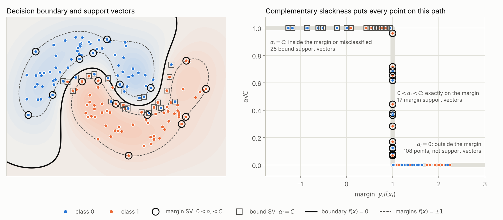
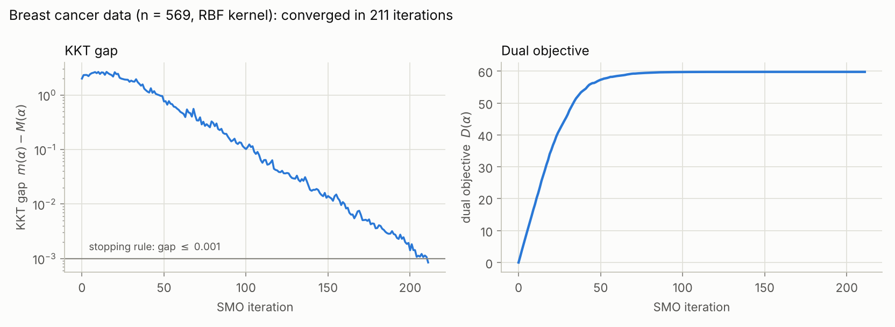
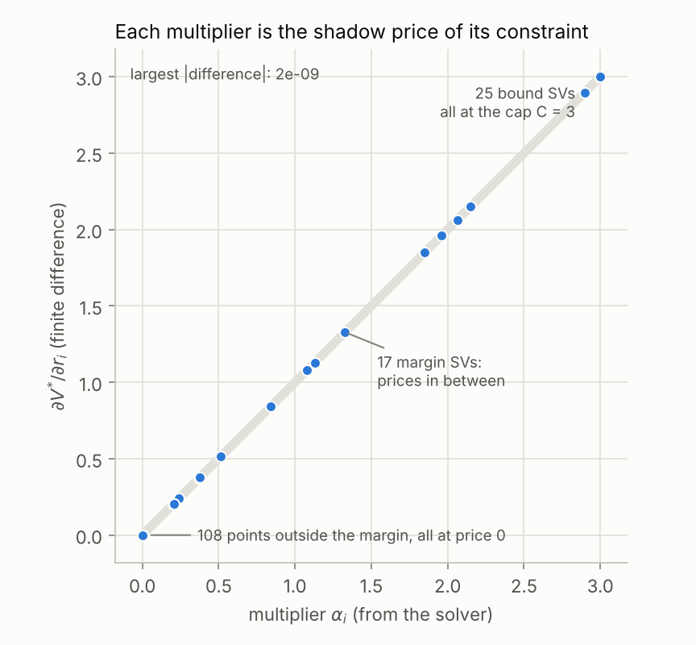

# KKT-SVM

This is a support vector machine that I built from scratch in NumPy as a side project. I had learnt how SVMs work in theory and had studied the Karush-Kuhn-Tucker (KKT) conditions in economics, so I wanted to learn by doing and build one where the KKT conditions do the work.

The solver uses the KKT conditions to pick which two multipliers to update at each step and to decide when to stop. Complementary slackness then sorts the points into support vectors and the rest. I also checked numerically that each multiplier is the shadow price of its point's margin constraint, which is how economics reads a Lagrange multiplier.

I tested it on five benchmark datasets, and it makes the same predictions and finds the same support vectors as scikit-learn's `SVC` (which runs LIBSVM).



## Running it

The code needs NumPy, scikit-learn and matplotlib. To install them and run the tests:

```bash
git clone https://github.com/navinokcan/Support-Vector-Machine.git
cd Support-Vector-Machine
pip install -r requirements.txt
pytest
```

This is how I use it on the moons data:

```python
from sklearn.datasets import make_moons
from svm_kkt import KKTSVM, kkt_report

X, y = make_moons(150, noise=0.25, random_state=7)
model = KKTSVM(C=3.0, kernel="rbf", gamma=2.0).fit(X, y)

model.margin_support_   # support vectors exactly on the margin (0 < alpha < C)
model.bound_support_    # support vectors inside the margin (alpha = C)
kkt_report(model, X, y) # every KKT condition, recomputed from the fitted model
```

## The maths

### The problem

The soft-margin SVM looks for the widest margin that most points respect, and pays a penalty $`C`$ for each unit a point falls short:

```math
\min_{w,\,b,\,\xi}\ \ \tfrac12\lVert w\rVert^2 + C\sum_{i=1}^{n}\xi_i
\qquad\text{subject to}\qquad
y_i f(x_i) \ \ge\ 1-\xi_i,\quad \xi_i \ge 0, \qquad f(x) = w^\top\phi(x) + b .
```

Every training point gets a margin constraint (multiplier $`\alpha_i`$) and a slack constraint (multiplier $`\mu_i`$).

### The KKT conditions

| Condition | Equations |
|---|---|
| Stationarity | $`w=\sum_i\alpha_i y_i\phi(x_i)`$,  $`\sum_i\alpha_i y_i=0`$,  $`\alpha_i+\mu_i=C`$ |
| Primal feasibility | $`y_i f(x_i)\ge 1-\xi_i`$,  $`\xi_i\ge0`$ |
| Dual feasibility | $`\alpha_i\ge0`$,  $`\mu_i\ge0`$, so $`0\le\alpha_i\le C`$ |
| Complementary slackness | $`\alpha_i\,[y_i f(x_i)-1+\xi_i]=0`$,  $`\mu_i\xi_i=0`$ |

The problem is convex and the constraints are affine, so these conditions are necessary and sufficient. This means checking them is enough to tell whether a solution is optimal, which is what `kkt_report()` does.

Complementary slackness is the part that picks out the support vectors. A multiplier can only be non-zero if its constraint binds, so each point ends up in one of three cases. These are the three legs of the path in the right-hand plot above:

| Multiplier | What complementary slackness forces | Meaning |
|---|---|---|
| $`\alpha_i = 0`$ | $`y_i f(x_i) \ge 1`$ | Outside the margin, not a support vector |
| $`0 < \alpha_i < C`$ | $`y_i f(x_i) = 1`$ | Exactly on the margin (margin support vector) |
| $`\alpha_i = C`$ | $`y_i f(x_i) \le 1`$ | Inside the margin or misclassified (bound support vector) |

Stationarity gives $`f(x)=\sum_{i:\,\alpha_i>0}\alpha_i y_i K(x_i,x)+b`$, so only the support vectors are needed to make predictions.

### The solver (SMO, guided by the KKT gap)

The dual is a quadratic programme in the multipliers:

```math
\max_{\alpha}\ \ \sum_i \alpha_i - \tfrac12\sum_{i,j}\alpha_i\alpha_j y_i y_j K(x_i,x_j)
\qquad\text{subject to}\qquad
\sum_i y_i\alpha_i = 0,\quad 0\le\alpha_i\le C .
```

I write $`G = Q\alpha - \mathbf{1}`$ for the gradient of the dual (as a minimisation), with $`Q_{ij}=y_iy_jK(x_i,x_j)`$. Following Keerthi et al. (2001), the KKT conditions of the dual come down to one inequality:

```math
m(\alpha) = \max_{t\,\in\, I_{\text{up}}} -y_t G_t \;\;\le\;\; \min_{t\,\in\, I_{\text{low}}} -y_t G_t = M(\alpha),
```

```math
I_{\text{up}} = \{t:\alpha_t<C,\ y_t=+1\}\cup\{t:\alpha_t>0,\ y_t=-1\},\qquad
I_{\text{low}} = \{t:\alpha_t<C,\ y_t=-1\}\cup\{t:\alpha_t>0,\ y_t=+1\}.
```

The way I read this is that $`-y_tG_t`$ is the bias that would put point $`t`$ exactly on its margin. Points in $`I_{\text{up}}`$ need $`b`$ to be at least that value, points in $`I_{\text{low}}`$ need it to be at most that value, and the KKT conditions hold exactly when one value of $`b`$ works for every point. So $`m(\alpha)-M(\alpha)`$, the KKT gap, measures how far the current multipliers are from optimal.

I based the solver on SMO. Each pass through the loop in `smo()` (in `svm_kkt.py`):

1. Checks the KKT conditions and picks $`i`$, the point violating them the most.
2. Picks a partner $`j`$ from the points that violate them together with $`i`$, choosing the one with the biggest guaranteed improvement, $`(\text{violation})^2/(K_{ii}+K_{jj}-2K_{ij})`$. For this I used LIBSVM's second-order rule from Fan, Chen & Lin (2005).
3. Takes the exact best step for $`\alpha_i`$ and $`\alpha_j`$. Moving along $`d_i=y_i`$, $`d_j=-y_j`$ keeps $`\sum_i y_i\alpha_i=0`$, the objective along that line is a 1-D quadratic, and the step gets clipped so both multipliers stay in $`[0, C]`$.
4. Updates the gradient in $`O(n)`$ using two columns of the kernel matrix.
5. Stops once the KKT gap is at most `tol`.

At the end, $`b`$ comes out as the multiplier on $`\sum_i y_i\alpha_i=0`$. For any margin support vector it is equal to $`-y_iG_i`$.

On the breast cancer data the gap drops below `tol` after 211 iterations, while the dual objective climbs and then levels off:



## Multipliers as shadow prices

This is the part that links back to economics. The KKT conditions come from optimisation (Karush, 1939; Kuhn & Tucker, 1951), but economics is where the multipliers are read as shadow prices: how fast the optimal value changes when a constraint is tightened.

For the SVM, suppose point $`i`$ has to reach margin $`r_i`$ instead of 1, and let $`V^\star(r)`$ be the optimal objective. The envelope theorem gives

```math
\frac{\partial V^\star}{\partial r_i} = \alpha_i ,
```

so $`\alpha_i`$ is the marginal cost of asking point $`i`$ for more margin. Complementary slackness then looks a lot like a market. A point outside the margin has a slack constraint, so its price is zero, like a free good. On the margin the constraint binds and the price is positive. Inside the margin the price hits a cap of $`C`$, because slack can always be bought at $`C`$ per unit instead.

I checked this numerically with `shadow_prices()`. It re-solves the SVM with each $`r_i`$ nudged up and down, then compares the finite-difference derivative with $`\alpha_i`$. All 150 points match to within $`2\times10^{-9}`$:

<p align="center"></p>

Building this showed me how much of the maths I had learnt in economics carries over to machine learning.

## Comparing with scikit-learn

I compared my SVM with scikit-learn's `SVC` using `benchmarks/scikit_comparison.py`. Both use the same `C`, kernel, `gamma` and `tol=1e-3`, and I tested them on a held-out 30% split:

| Dataset | Kernel | n (train) | Test acc. (mine / sklearn) | Same predictions | Support vectors (mine / sklearn) | Same SVs | max abs diff in f(x) | Iterations (mine / sklearn) | Fit ms (mine / sklearn) |
|---|---|--:|:-:|:-:|:-:|:-:|--:|:-:|:-:|
| moons | rbf | 700 | 0.950 / 0.950 | 100% | 172 / 172 | yes | 2.6e-03 | 172 / 156 | 23 / 5 |
| circles | rbf | 700 | 0.993 / 0.993 | 100% | 89 / 89 | yes | 1.6e-03 | 139 / 121 | 17 / 3 |
| breast cancer | rbf | 398 | 0.953 / 0.953 | 100% | 96 / 96 | yes | 6.6e-04 | 156 / 164 | 9 / 3 |
| breast cancer | linear | 398 | 0.953 / 0.953 | 100% | 27 / 27 | yes | 6.4e-03 | 956 / 903 | 42 / 3 |
| digits 3 vs 8 | rbf | 249 | 1.000 / 1.000 | 100% | 107 / 107 | yes | 3.7e-04 | 209 / 199 | 10 / 2 |

They agree on every prediction and pick the same support vectors on all five datasets. The decision values differ by a few multiples of `tol`, which makes sense because both solvers stop once the KKT gap is under `tol` rather than at the exact optimum. At `tol=1e-6` they agree to within $`10^{-4}`$, and the tests check this. The iteration counts are close because I used the same pair-selection rule as LIBSVM. LIBSVM is still about 3 to 20 times faster, since it is compiled C++ and uses a shrinking heuristic, while mine is a Python loop.

## What is in the repo

```text
svm_kkt.py                       KKTSVM class, smo() solver, kkt_report(), shadow_prices()
benchmarks/scikit_comparison.py  The comparison table above
notebooks/visualization.ipynb    Makes every figure in this README
tests/test_kkt.py                Unit tests: textbook cases, KKT conditions, sklearn parity, shadow prices
figures/                         Images used in this README
```

## Limitations

I only implemented binary classification, so for more than two classes it would need to be wrapped in a one-vs-one or one-vs-rest scheme. I also store the full $`n\times n`$ kernel matrix, which is fine up to a few thousand points. And it is slower than LIBSVM, which caches kernel columns and skips points that are unlikely to change.
